<p align="center">
  
</p>

<h1 align="center">Crypto Hunter</h1>

<p align="center">
  A real-time crypto tracker with streaming prices, candlestick charts, a portfolio, price alerts, live news and an AI market copilot, in an iOS-style "liquid glass" interface.
</p>

<p align="center">
  React 19 · Vite · Tailwind CSS v4 · Motion · TanStack Query · Vercel Functions · Groq / Claude
</p>

<p align="center">
  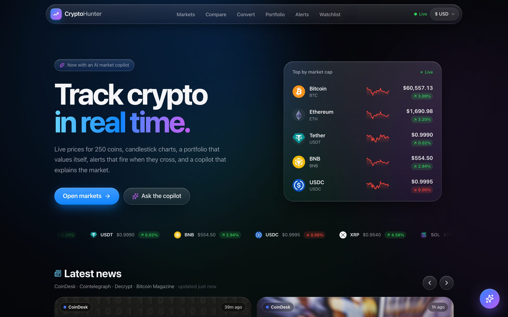
</p>

## Highlights

- **Live prices**, streamed from Binance over a WebSocket and batched to one render per frame.
- **AI copilot** that answers from live market data and the latest news, cites its sources, and draws charts inside its replies.
- **Portfolio and price alerts**, valued and checked against every live tick.
- **News carousel** of photo banners from four crypto outlets, cached at three levels.
- **Glass UI** with spring animations and page transitions, on desktop and mobile.

## Screenshots

### Desktop

<table>
  <tr>
    <td width="50%">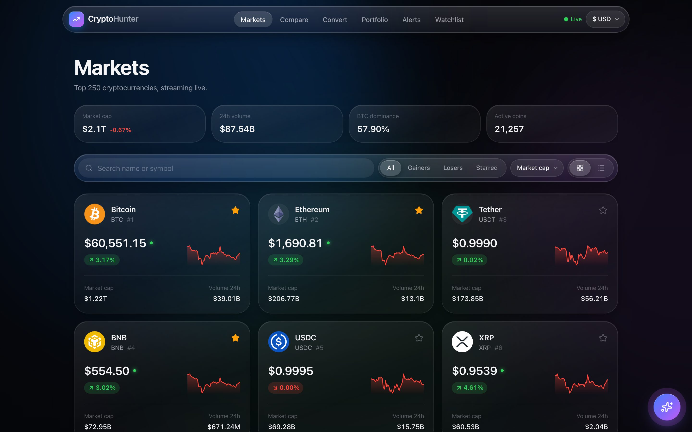<br /><sub><b>Markets</b>: 250 coins, live prices, 7-day sparklines, search, filters and sorting</sub></td>
    <td width="50%">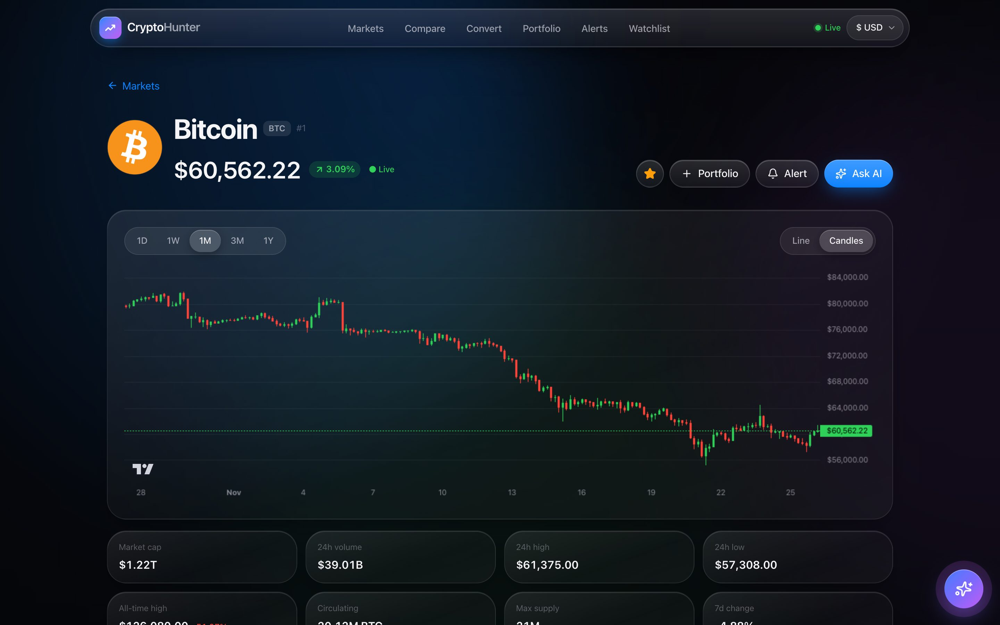<br /><sub><b>Coin detail</b>: candlesticks or line chart, with the newest bar updating live</sub></td>
  </tr>
  <tr>
    <td>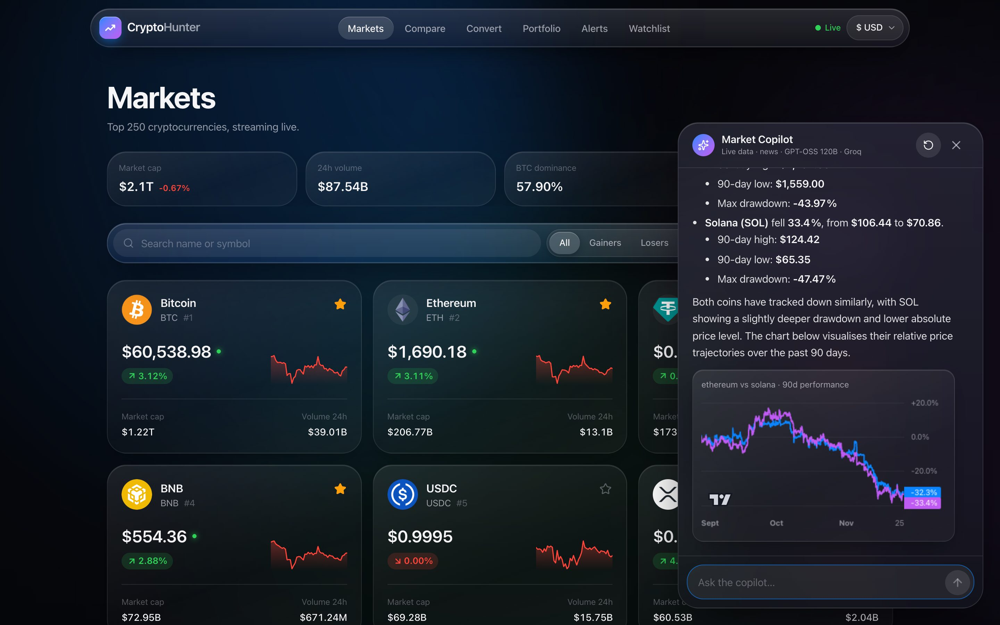<br /><sub><b>AI copilot</b>: grounded answers with charts drawn inside the reply</sub></td>
    <td>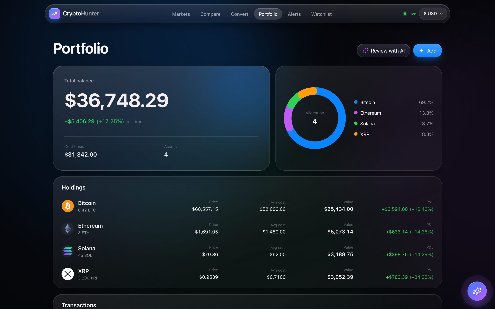<br /><sub><b>Portfolio</b>: average-cost P&L and allocation, valued live</sub></td>
  </tr>
  <tr>
    <td>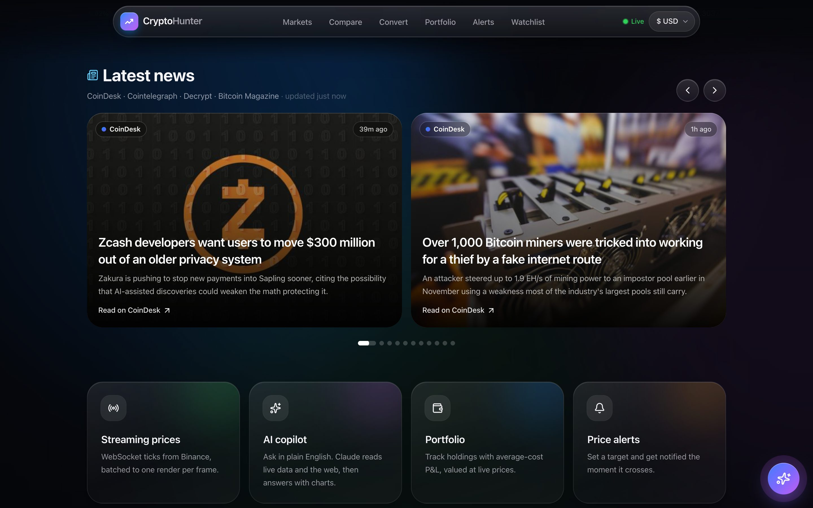<br /><sub><b>Latest news</b>: auto-playing, swipeable photo banners</sub></td>
    <td>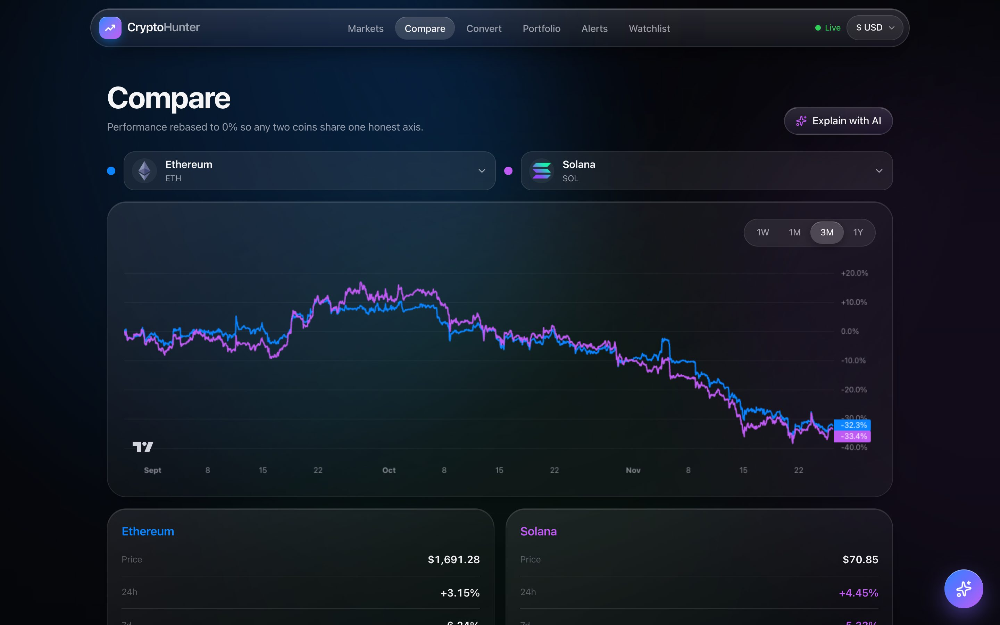<br /><sub><b>Compare</b>: performance rebased to 0% on one axis</sub></td>
  </tr>
</table>

### Mobile

<table>
  <tr>
    <td width="33%">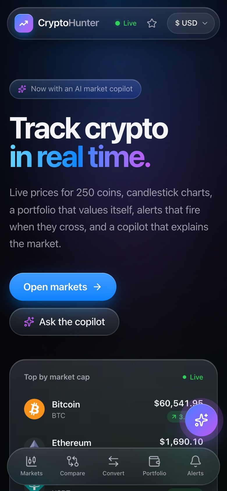<br /><sub><b>Home</b></sub></td>
    <td width="33%">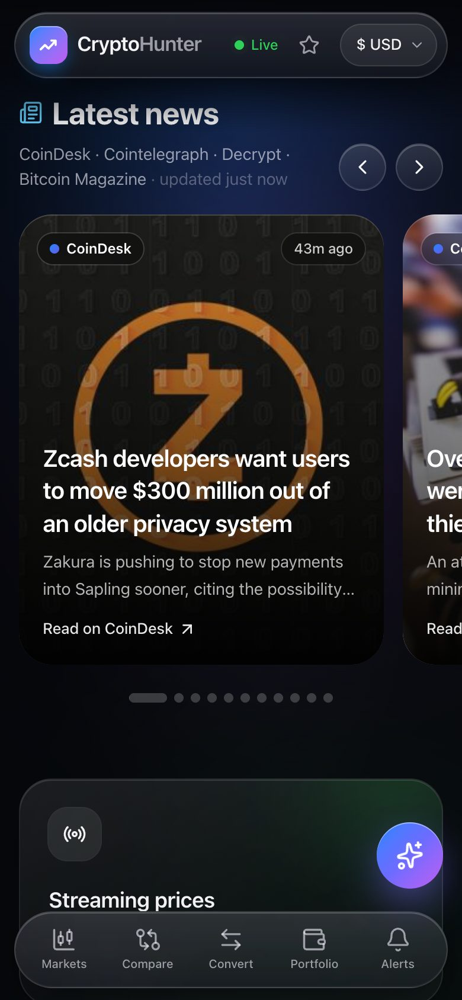<br /><sub><b>News carousel</b></sub></td>
    <td width="33%">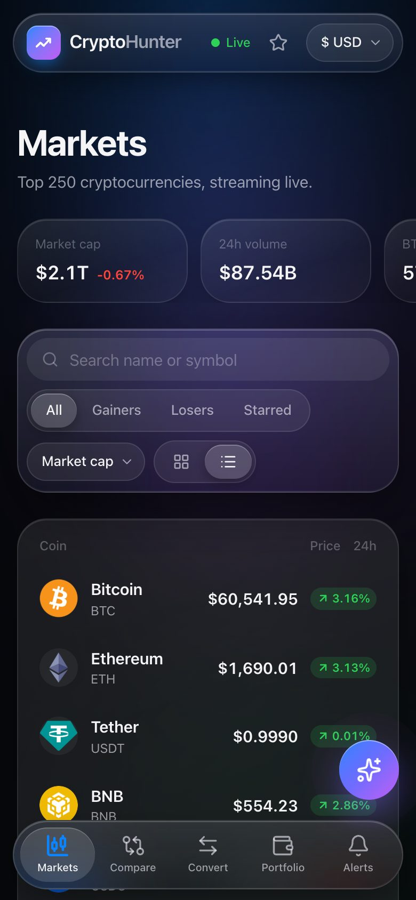<br /><sub><b>Markets (list view)</b></sub></td>
  </tr>
  <tr>
    <td>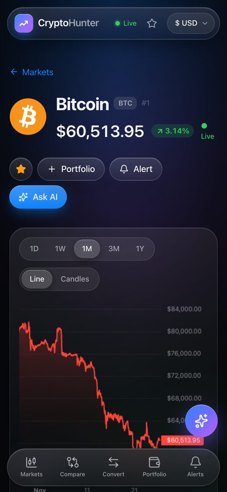<br /><sub><b>Coin detail</b></sub></td>
    <td>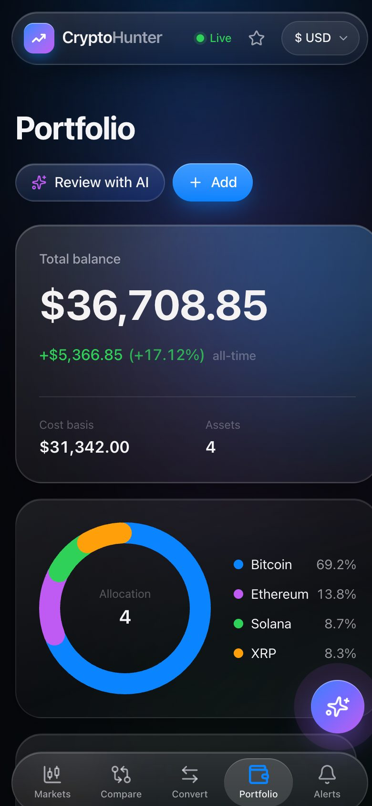<br /><sub><b>Portfolio</b></sub></td>
    <td>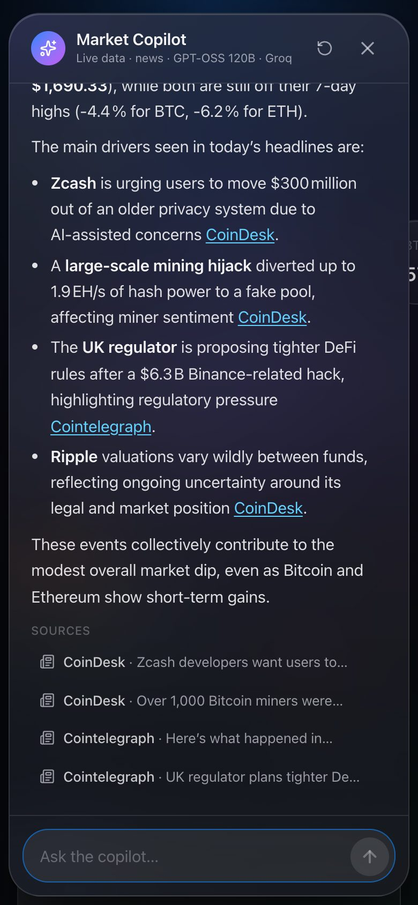<br /><sub><b>AI copilot, with sources</b></sub></td>
  </tr>
</table>

<sub>Screenshots use live market data and a demo portfolio.</sub>

## Features

| | |
|---|---|
| **Live prices** | Binance WebSocket stream (`!miniTicker@arr`) merged with CoinGecko snapshots. Prices flash green or red on every tick, and a "Live" indicator shows the connection state. |
| **AI copilot** | Ask "Why is the market moving today?" or "Compare ETH and SOL over 90 days". It answers from live market data and the latest headlines, links its sources, and draws charts inside the reply. It knows your watchlist and portfolio. The model can be swapped: GPT-OSS 120B on Groq's free tier, or Claude. Open it with `⌘J`. |
| **News** | An auto-playing, swipeable carousel of photo banners from CoinDesk, Cointelegraph, Decrypt and Bitcoin Magazine. It pauses on hover, focus or swipe, and when it's off screen. |
| **Portfolio** | Log buys and sells. Average-cost P&L and an allocation donut, valued at live prices in any currency. Data stays on the device. |
| **Price alerts** | "Notify me when ETH goes above X." Checked against every live tick, with system notifications while the app is open. |
| **Charts** | TradingView Lightweight Charts: line or candlesticks, 1D to 1Y, with the newest bar updating live. |
| **Compare / Convert** | Performance rebased to 0% on one axis, and live cross rates between any two coins. |
| **Markets** | 250 coins with search, filters and sorting, grid or list view, 7-day sparklines and infinite scroll. Filters and sorting live in the URL, so a view can be shared. |
| **Watchlist** | Star any coin; it updates instantly everywhere. |
| **Currencies** | USD, INR (lakh/crore grouping), EUR, GBP. Switching is instant. |
| **Installable** | Web app manifest with a maskable icon, so it installs to the home screen like a native app. |

## Architecture

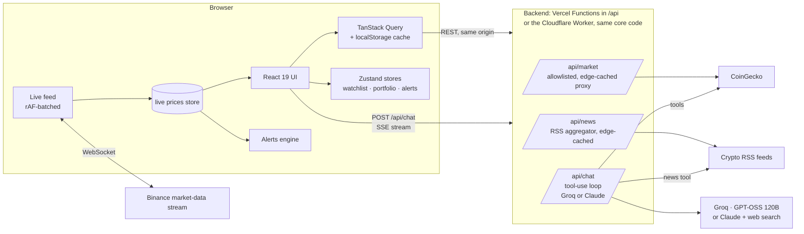

**Frontend:** Vite, React 19, React Router 8 (View Transitions), TanStack Query, Zustand, Motion, Tailwind CSS v4, Lightweight Charts, vaul, sonner.
**Backend:** platform-neutral code in `worker/src/` (standard `Request`/`Response`/streams, zod, swappable LLM providers), served by **Vercel Functions** in `api/` in production and by a **Cloudflare Worker** in local development. Both run the identical chat, news and market code.

```
src/
  components/   layout (nav, tab bar), ui (glass primitives), market, chart, news, copilot, portfolio, alerts
  hooks/        TanStack Query hooks, live quotes, alerts engine
  lib/          pure logic: api, formatting, sorting, portfolio math, live-quote merging (unit-tested)
  pages/        route components (code-split)
  store/        Zustand stores (persisted)
api/            Vercel Functions: chat, news, market, health (thin adapters over worker/src)
worker/src/     shared backend core (also deployable as a Cloudflare Worker)
  chat.js       request parsing + SSE streaming, platform-neutral
  providers/    claude.js, groq.js: one interface, swappable
  tools.js      copilot tools (zod-validated)
  news.js       RSS aggregation and image extraction
  marketProxy.js, citations.js, prompt.js, index.js
```

## Engineering notes

These are the decisions worth discussing in a review or interview.

**Real-time data**
- **Streaming without re-render storms.** Binance sends updates for about 400 symbols every second. Ticks go into a buffer that is flushed into the store at most once per animation frame (with a timer fallback in background tabs, so alerts still fire). Each row subscribes only to its own symbol, so only rows whose price changed re-render. Reconnects use exponential backoff with jitter.
- **Trusting live data carefully.** Binance quotes in USDT. Prices are converted with the live USDT→fiat rate, stablecoins are excluded, and any tick more than 8% away from CoinGecko is ignored, because that usually means a different asset shares the ticker.
- **Shared CDN cache.** CoinGecko's free tier rate-limits each IP. Market data goes through our own `/api/market` proxy, which accepts only an allowlist of read-only paths and returns `s-maxage` headers (60 to 300 seconds), so Vercel's CDN serves one cached copy to every visitor. The copilot's own CoinGecko calls use a small in-memory cache with in-flight de-duplication. If no backend answers (static hosting, or `npm run dev` without the Worker), the app falls back to CoinGecko directly.
- **One build, any host.** The UI asks `/api/health` at runtime whether a backend and an AI key exist, and shows the copilot and news accordingly, so the same build works on Vercel, locally, or on static hosting with those features hidden.

**AI copilot**
- **Tool-use loop.** A manual loop streams over Server-Sent Events. The tools are `search_coins`, `get_market_overview`, `get_coin`, `get_price_history`, `get_crypto_news` and `show_chart`, plus server-side `web_search` on Claude. Tool inputs are validated with zod, and coin ids are pinned to a strict charset because they are interpolated into URLs. `show_chart` is a UI tool: the Worker sends a `chart` event and the browser draws the chart inline in the reply.
- **Swappable model layer.** Each provider in `worker/src/providers/` implements the same interface (`run`, `publicMessage`, `keyName`) and shares the tools and system prompt. Development runs free on Groq; switching to Claude is one setting. The Claude provider uses eager input streaming, handles `pause_turn`, `max_tokens` and refusal stop reasons, enables server-side refusal fallback, and prompt-caches the system prompt and tools.
- **Making a free model trustworthy.** Smaller open models are more likely to invent things, so the Groq provider adds safeguards:
  - Every number and every cause must come from a tool result in the conversation.
  - The model's 【Source】 citation markers are rewritten into real links as the reply streams, even when a marker is split across chunks. The articles it read are also listed as Sources.
  - Errors Groq reports inside a 200 response are surfaced, not skipped. A rejected tool call is retried with the validation error fed back, so the model corrects itself instead of repeating the mistake. Empty turns are retried.
  - Groq's free tier allows about 8K tokens per minute, so tool calls are batched into one step, reasoning effort is kept low, tool outputs are trimmed, and short 429 windows are waited out while the chat shows "waiting".

**News**
- **Aggregation.** `/api/news` merges four RSS feeds, pulls cover images (https only), removes duplicate stories, and caps each outlet so the mix stays varied.
- **Three cache layers.** The Cloudflare edge (5 minutes), TanStack Query in memory, and `localStorage`, so the next visit renders instantly and refreshes in the background. If the service is down, the section shows a Retry card instead of disappearing.
- **Carousel.** Native scroll-snap for swiping. Autoplay is driven by the progress bar's `animationend` event, so pausing (on hover, focus, swipe, an off-screen carousel or a hidden tab) can't drift out of sync. With reduced motion, autoplay is off.

**Interface**
- **Glass that stays fast.** Real `backdrop-filter` blur is expensive, so it is used only on floating chrome (nav, tab bar, sheets, copilot). Repeated cards use a cheaper glass look over an already-blurred background, so a grid of 250 cards keeps scrolling smoothly.
- **A subtle browser rule.** An element with a `view-transition-name` becomes a "backdrop root", and its blur can no longer see the page behind it. So the page transition name is applied only while a transition is running (`:active-view-transition`), and the nav keeps real blur.
- **Motion.** Shared springs are tuned to feel like UIKit. Route changes use the View Transitions API, and the coin logo morphs from card to detail page. Everything respects `prefers-reduced-motion`.

**Correctness and security**
- **Money.** Portfolio cost basis is stored in USD, so changing the display currency never rewrites history. Selling uses average cost and records realised P&L. While a new currency loads, the previous data is converted at the live FX rate, so a rupee sign is never shown next to dollar amounts.
- **Access rules.** The site and its API share one origin, so no CORS setup is needed. Requests from other websites are refused. The copilot, which spends API quota, always requires a same-site `Origin`, is rate-limited per IP, and caps request size and history. API keys exist only as server environment variables.
- **Testing.** Vitest unit tests cover sorting and filtering, live-quote merging, portfolio math, formatting, FX conversion, the news parser, citation rewriting, provider stream handling and retries, and access rules, plus a component test. GitHub Actions runs tests and builds for both packages.

## Getting started

```bash
npm install && npm --prefix worker install
cp worker/.dev.vars.example worker/.dev.vars   # add a free GROQ_API_KEY from console.groq.com
npm run dev:all                                # Worker on :8787, app on :5173
```

- Live prices and charts work without any keys. The copilot needs `GROQ_API_KEY` (free, no card) or `ANTHROPIC_API_KEY`.
- Vite forwards `/api` to the Worker. `DEV_ALLOW_LOCALHOST=true` in `.dev.vars` lets the Worker accept any `localhost` port, because Vite moves to 5174, 5175 and so on when 5173 is busy.
- If port 8787 is already in use, stop the old Worker with `pkill -f "wrangler dev"`.

### Deploy (Vercel)

Push to GitHub and import the repo in Vercel. `vercel.json` already sets the Vite build, the `dist/` output, the API rewrites and caching, so there's nothing to configure in the build settings. Then add the environment variables below under **Settings → Environment Variables** and redeploy.

| Variable | Required | Notes |
|---|---|---|
| `GROQ_API_KEY` | For the copilot | Free at [console.groq.com](https://console.groq.com), no card needed. Without it, the copilot stays hidden and everything else works. |
| `COINGECKO_API_KEY` | Recommended | Free CoinGecko demo key. Raises the rate limits for the market proxy and the copilot's data tools. Stays on the server. |
| `ANTHROPIC_API_KEY` | Optional | Use Claude instead of Groq (Claude is preferred when this key exists). |
| `LLM_PROVIDER` | Optional | `groq` or `claude`, to force one. |
| `ALLOWED_ORIGINS` | Optional | Extra origins allowed to call the API, comma-separated. Your own domain and preview URLs already work. |

No `VITE_*` variables are needed: the site and API share a domain.

**Alternative: Cloudflare.** `cd worker && npx wrangler secret put GROQ_API_KEY && npm run deploy`, then build the frontend with `VITE_API_URL` set to the Worker's URL, and list the site's origin in `ALLOWED_ORIGINS` in [worker/wrangler.jsonc](worker/wrangler.jsonc).

### Tests

```bash
npm run test:all
```

Chart rendering by [TradingView Lightweight Charts](https://www.tradingview.com/lightweight-charts/). Market data from [CoinGecko](https://www.coingecko.com/) and Binance. News from CoinDesk, Cointelegraph, Decrypt and Bitcoin Magazine.
