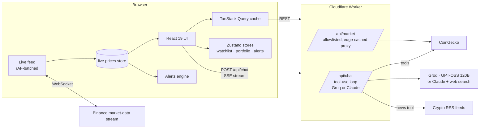

# Crypto Hunter

A real-time crypto tracker with streaming prices, candlestick charts, a portfolio, price alerts and an AI market copilot, presented in an iOS-style "liquid glass" interface.

> v2 is a ground-up rewrite of the original Create React App + MUI version. See [What changed from v1](#what-changed-from-v1).

## Features

| | |
|---|---|
| **Live prices** | Binance WebSocket stream (`!miniTicker@arr`) merged with CoinGecko snapshots. Prices flash green or red on every tick. |
| **AI copilot** | Ask "Why is SOL down today?" or "Compare ETH and SOL over 90 days". It answers from live market data and the latest news, cites its sources, and draws charts inside the reply. It also knows your watchlist and portfolio. The model can be swapped: GPT-OSS 120B on Groq's free tier, or Claude. Press `⌘J` to open it. |
| **Portfolio** | Log buys and sells. Average-cost P&L and an allocation donut, valued at live prices in any currency. |
| **Price alerts** | "Notify me when ETH goes above X." Checked against every live tick, with system notifications while the app is open. |
| **Charts** | TradingView Lightweight Charts: line or candlesticks, 1D to 1Y, with the newest bar updating live. |
| **News** | An auto-playing, swipeable carousel of photo banners on the home page, built from CoinDesk, Cointelegraph, Decrypt and Bitcoin Magazine. |
| **Compare / Convert** | Performance rebased to 0% on one axis, and live cross rates between any two coins. |
| **Markets** | 250 coins with search, filters and sorting, grid or list view, 7-day sparklines, and infinite scroll. Filter and sort live in the URL, so a view can be shared. |
| **Currencies** | USD, INR (lakh/crore grouping), EUR, GBP. Switching is instant. |

## Architecture



**Frontend:** Vite, React 19, React Router 8 (View Transitions), TanStack Query, Zustand, Motion, Tailwind CSS v4, Lightweight Charts, vaul, sonner.
**Backend:** one Cloudflare Worker using zod, with swappable LLM providers (Groq's OpenAI-compatible API, or the Anthropic SDK).

## Engineering notes

These are the decisions worth discussing in a review or interview.

- **Streaming without re-render storms.** Binance sends updates for about 400 symbols every second. Ticks go into a buffer that is flushed into the store at most once per animation frame (with a timer fallback in background tabs, so alerts still fire). Each row subscribes only to its own symbol, so only rows whose price changed re-render. Reconnects use exponential backoff with jitter.
- **Trusting live data carefully.** Binance quotes in USDT. Prices are converted with the live USDT→fiat rate, stablecoins are excluded, and any tick more than 8% away from CoinGecko is ignored, because that usually means a different asset shares the ticker.
- **Glass that stays fast.** Real `backdrop-filter` blur is expensive, so it is used only on floating chrome (nav, tab bar, sheets, copilot). Repeated cards use a cheaper glass look over an already-blurred background, so a grid of 250 cards keeps scrolling smoothly.
- **Motion.** Shared springs are tuned to feel like UIKit. Route changes use the View Transitions API, and the coin logo morphs from card to detail page. Everything respects `prefers-reduced-motion`.
- **Copilot loop.** A manual tool-use loop streams over Server-Sent Events. The tools are `search_coins`, `get_market_overview`, `get_coin`, `get_price_history`, `show_chart` and server-side `web_search`.
  - Inputs stream eagerly and are validated with zod. Coin ids are pinned to a strict charset because they are interpolated into URLs.
  - Parallel tool calls return their results in one message.
  - `pause_turn`, `max_tokens` and refusal stop reasons are handled, and server-side refusal fallback is enabled.
  - The system prompt and tools are prompt-cached.
  - `show_chart` is a UI tool: the Worker sends a `chart` event and the browser draws the chart inline in the reply.
- **Swappable model layer.** Each provider (`worker/src/providers/`) implements the same interface (`run`, `publicMessage`, `keyName`) and shares one set of tools and one system prompt. Development runs free on Groq; switching to Claude is one setting.
- **Making a free model trustworthy.** Smaller open models are more likely to invent things, so the Groq provider adds safeguards:
  - Every number and every cause must come from a tool result in the conversation (prompt rule, checked by hand against real answers).
  - The model's 【Source】 citation markers are rewritten into real links as the reply streams, even when a marker is split across chunks.
  - The articles it read are shown as a Sources list regardless of whether it cites them.
  - Groq's free tier allows about 8K tokens per minute, so tool calls are batched into one step, reasoning effort is kept low, tool outputs are trimmed, and short 429 windows are waited out while the chat shows "waiting".
- **Free news.** A `get_crypto_news` tool reads CoinDesk, Cointelegraph, Decrypt and Bitcoin Magazine RSS feeds. They are edge-cached for 5 minutes, parsed with a small hardened parser (only http(s) links are kept, bad dates are tolerated), and matched on whole words.
- **News carousel and caching.** `/api/news` merges four RSS feeds, pulls cover images (https only), removes duplicates, and limits each outlet so the mix stays varied. It is cached at three levels: the Cloudflare edge (5 minutes), TanStack Query in memory, and `localStorage`, so the next visit renders instantly and refreshes in the background. The carousel uses native scroll-snap for swiping. Autoplay is driven by the progress bar's `animationend` event, so pausing (on hover, focus, swipe, an off-screen carousel or a hidden tab) can't drift out of sync. With reduced motion, autoplay is off.
- **Shared edge cache.** CoinGecko's free tier rate-limits each IP. With `VITE_API_URL` set, market data goes through the Worker. The proxy accepts only an allowlist of read-only paths and caches responses at the edge (60 to 300 seconds), so every visitor shares one cache.
- **Abuse protection.** The Worker checks CORS against an origin allowlist, rate-limits chat requests per IP, caps request size and history, and keeps the API key on the server.
- **Money correctness.** Portfolio cost basis is stored in USD, so changing the display currency never rewrites history. Selling uses average cost and records realised P&L. While a new currency loads, the previous data is converted at the live FX rate, so a rupee sign is never shown next to dollar amounts.
- **Testing.** Vitest unit tests cover sorting and filtering, live-quote merging, portfolio math, formatting, FX conversion and Worker tool validation, plus a component test for the segmented control. GitHub Actions runs tests and builds for both packages.

## Getting started

```bash
npm install
npm run dev                 # http://localhost:5173
```

Market data and live prices work with no keys.

### Copilot (Cloudflare Worker)

```bash
cd worker
npm install
cp .dev.vars.example .dev.vars   # add a free GROQ_API_KEY (console.groq.com), or an ANTHROPIC_API_KEY
npm run dev                      # http://localhost:8787
```

Or start both at once from the repo root with `npm run dev:all` (Worker on :8787, app on :5173).

Vite forwards `/api/chat` to the Worker. In local dev, `DEV_ALLOW_LOCALHOST=true` in `.dev.vars` lets the Worker accept any `localhost` port, because Vite moves to 5174, 5175 and so on when 5173 is busy. Production only accepts the origins in `ALLOWED_ORIGINS`. To also send market data through the Worker's cache in development, run the frontend with `VITE_API_URL=http://localhost:8787 npm run dev`.

### Deploy

```bash
cd worker && npx wrangler secret put GROQ_API_KEY && npm run deploy   # or ANTHROPIC_API_KEY
```

Then set `VITE_API_URL` to the Worker's URL in Vercel, and add your site's origin to `ALLOWED_ORIGINS` in [worker/wrangler.jsonc](worker/wrangler.jsonc).

### Tests

```bash
npm run test:all
```

## What changed from v1

| v1 | v2 |
|---|---|
| Prices polled every 5 minutes | WebSocket ticks, batched once per frame |
| `coins.sort()` mutated React state | Pure selector functions with unit tests |
| "Top gainers" sort was backwards | Fixed, with a test |
| One `<ToastContainer>` per card (about 100) | One app-level toaster |
| `<Link>` wrapping `<tr>` (invalid HTML) | Overlay links, with no interactive elements nested inside links |
| Watchlist read `localStorage` once, so it didn't update | Persisted Zustand store (old `starred` data is migrated) |
| Market cap always in USD | Every figure in the selected currency |
| Dual y-axes in Compare | Performance rebased to 0% on one honest axis |
| No error, loading or rate-limit handling | Skeletons, error states, backoff on 429s, route-level error boundary |
| CRA + MUI (CRA is deprecated) | Vite + Tailwind v4, code-split routes |

Chart rendering by [TradingView Lightweight Charts](https://www.tradingview.com/lightweight-charts/). Market data from [CoinGecko](https://www.coingecko.com/) and Binance.
